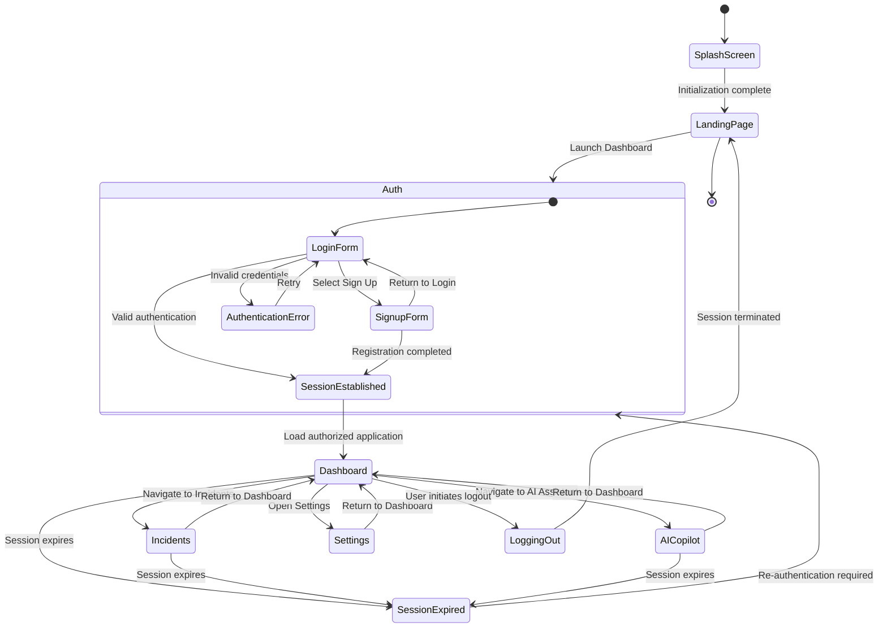

# OpsMind — User Journey & Application Flow

**Document ID:** OPSMIND-UX-001  
**Document Owner:** Aryan Thakur — Lead Engineer  
**Document Status:** Approved  
**Version:** 1.0.0  
**Document Type:** Product & Engineering Specification  
**Last Updated:** November 2026

---

## 1. Purpose & Scope

This document defines the end-to-end user experience, application navigation, authentication lifecycle, system state transitions, component hierarchy, and failure-handling behavior of the OpsMind platform.

It serves as a shared engineering reference for frontend development, backend integration, application architecture, and quality assurance.

The primary objective is to establish a predictable, secure, and consistent operational experience for engineers responsible for monitoring, investigating, and managing distributed infrastructure.

### 1.1 Design Objectives

OpsMind's application experience is guided by the following principles:

- **Operational efficiency:** Minimize navigation overhead during critical incidents.
- **Context preservation:** Maintain relevant incident and infrastructure context across workflows.
- **Predictable behavior:** Define explicit application states and transitions.
- **Security by design:** Protect user sessions, credentials, and privileged operations.
- **Failure resilience:** Provide meaningful recovery paths when services become unavailable.
- **Accessibility:** Ensure usability across supported devices and interaction methods.

---

## 2. Information Architecture & Navigation

OpsMind uses a role-aware navigation architecture that separates public application entry points from authenticated operational functionality.

### 2.1 Public Routes

Public routes are accessible without an authenticated session.

| Route | Module | Responsibility |
|---|---|---|
| `/` | Landing Page | Product introduction, platform capabilities, and value proposition |
| `/auth` | Authentication | User login, registration, and authentication recovery |

### 2.2 Protected Routes

Protected routes require a valid authenticated session and the appropriate authorization permissions.

| Route | Module | Responsibility |
|---|---|---|
| `/dashboard` | Command Center | Infrastructure health, telemetry, and operational KPIs |
| `/incidents` | Incident Management | Incident creation, investigation, prioritization, and lifecycle management |
| `/ai-copilot` | AI Assistant | Natural-language operational queries and investigation assistance |
| `/runbooks` | Automation Center | Controlled execution of operational runbooks |
| `/connect-data` | Integrations | Configuration and management of external infrastructure connections |
| `/security` | Security Center | Security events, vulnerabilities, and infrastructure risk visibility |
| `/policies` | Policy Management | Policy configuration and compliance evaluation |
| `/audit-logs` | Audit & Governance | Traceable records of security-sensitive and operational activities |
| `/settings` | User Settings | Account preferences and application configuration |

### 2.3 Navigation Requirements

The navigation system must:

- Enforce authentication and authorization at the route level.
- Prevent unauthorized access to restricted modules.
- Preserve relevant navigation context when moving between related workflows.
- Provide consistent active-route indicators.
- Support browser history and direct URL navigation.
- Display loading, access-denied, and not-found states.
- Adapt navigation visibility according to user permissions.

**Engineering requirement:** Frontend route protection must complement—not replace—backend authorization. Every protected API operation must independently validate the caller's permissions.

---

## 3. End-to-End User Journey Maps

### 3.1 Primary Journey — Incident First Responder

**Objective:** Enable an SRE to identify, investigate, and resolve an infrastructure incident while maintaining operational visibility and an auditable execution history.

**Actors:** Site Reliability Engineer (SRE), OpsMind Platform, Observability Services, AI Intelligence Layer.

#### Workflow

**Step 1 — Authentication**

The engineer accesses OpsMind and authenticates through the `/auth` route.

Following successful authentication:

- The backend validates the submitted credentials.
- An authenticated session is established.
- The application retrieves the user's authorized capabilities.
- The user is redirected to `/dashboard`.

**Step 2 — Incident Detection**

The Command Center displays an abnormal increase in API Gateway P95 latency.

The platform generates an incident notification:

`P1 Incident Created: API Gateway Availability Degraded`

The notification includes the incident identifier, severity, affected service, detection timestamp, and current status.

**Step 3 — Incident Investigation**

The engineer opens the notification and navigates to `/incidents`.

The incident detail view provides:

- Incident summary and severity.
- Affected infrastructure components.
- Detection and event timestamps.
- Related telemetry and logs.
- Incident status and ownership.
- Historical event timeline.

**Step 4 — AI-Assisted Investigation**

The engineer selects **Ask Copilot**.

The AI Assistant receives the authorized incident context and the engineer submits:

> Why is the API Gateway experiencing elevated latency?

The intelligence layer analyzes available telemetry and related operational signals.

Example recommendation:

> The API Gateway workload is showing elevated memory utilization. Affected container instances may be approaching their configured memory limits. Review recent deployment activity and container resource metrics before initiating remediation.

Recommendations must identify their supporting evidence and distinguish observed facts from inferred causes.

**Step 5 — Remediation Planning**

The engineer navigates to `/runbooks` and selects the relevant remediation procedure.

Example:

`Restart API Gateway Workload`

Before execution, OpsMind presents:

- Target environment and affected resources.
- Proposed operation.
- Required permissions.
- Expected operational impact.
- Approval requirements.
- Available rollback or recovery procedure.

**Step 6 — Controlled Execution**

The engineer reviews the operation and explicitly approves execution.

The automation engine:

1. Validates authorization.
2. Checks execution prerequisites.
3. Records the requested operation.
4. Executes the approved runbook.
5. Captures execution output.
6. Records the final operation status.

**Step 7 — Resolution Verification**

The observability layer evaluates the affected service after remediation.

The engineer verifies:

- API Gateway availability.
- P95 latency recovery.
- Error-rate reduction.
- Container health.
- Incident status.

The incident is marked resolved only after the required verification criteria are satisfied.

**Expected outcome:** A traceable incident lifecycle with evidence-backed investigation, controlled remediation, and verified recovery.

---

### 3.2 Secondary Journey — Infrastructure Onboarding

**Objective:** Enable a DevOps engineer to connect an AWS environment to OpsMind and begin collecting authorized infrastructure information.

**Actors:** DevOps Engineer, OpsMind Integration Service, AWS Identity and Access Management (IAM).

#### Workflow

**Step 1 — Access Integration Management**

The authenticated engineer opens `/connect-data`.

The integration interface displays supported providers and their connection requirements.

**Step 2 — Provider Selection**

The engineer selects Amazon Web Services (AWS).

The platform presents the required connection configuration and permissions.

**Step 3 — Secure Credential Configuration**

The recommended integration method is role-based authentication using AWS IAM roles and temporary credentials.

The configuration workflow may include:

- AWS account identifier.
- IAM role ARN.
- External ID, where applicable.
- Required permission scope.
- Region selection.

Long-lived access keys should not be the default integration method. If a supported workflow requires credentials, they must be transmitted securely and stored only through an appropriate secrets-management mechanism.

**Step 4 — Connection Validation**

The backend validates the connection using the AWS SDK for Python (Boto3).

Example identity-validation operation:

`boto3.client("sts").get_caller_identity()`

The integration service verifies:

- AWS identity.
- Account ownership.
- Role-assumption permissions.
- Required access scope.
- Provider connectivity.

**Step 5 — Connection Confirmation**

After successful validation:

- The integration status changes to `CONNECTED`.
- The configured account appears in the integrations inventory.
- The connection event is recorded in the audit log.
- Authorized telemetry collection can begin.

**Expected outcome:** A verified AWS integration with controlled permissions, secure credential handling, and an auditable connection lifecycle.

---

## 4. Application State & Navigation Lifecycle

The application follows an explicit state-transition model to maintain consistent behavior across initial loading, authentication, navigation, and session termination.

### 4.1 High-Level Application State Diagram



### 4.2 Application Initialization

During application startup, OpsMind must:

1. Initialize application configuration.
2. Load required static resources.
3. Validate the existing authentication session, if present.
4. Retrieve the current user's authorization context.
5. Initialize required application services.
6. Resolve the appropriate initial route.

The splash screen must not be treated as evidence that backend services are available. Service readiness should be determined through actual health checks.

### 4.3 Authentication State Model

| State | Description | Expected Behavior |
|---|---|---|
| `UNAUTHENTICATED` | No valid session exists | Public routes remain accessible |
| `AUTHENTICATING` | Credentials are being validated | Display submission state |
| `AUTHENTICATED` | Valid session established | Permit authorized navigation |
| `SESSION_EXPIRED` | Session is no longer valid | Initiate controlled re-authentication |
| `ACCESS_DENIED` | User lacks required permissions | Display an authorization error |
| `LOGGING_OUT` | Session termination is in progress | Disable privileged interactions |

---

## 5. Frontend Component Architecture

The frontend follows a component-based architecture with clear separation between application layout, route-level pages, reusable interface elements, and data-access services.

### 5.1 Application Hierarchy

```text
App
│
├── ApplicationProviders
│   ├── AuthenticationProvider
│   ├── ThemeProvider
│   └── NotificationProvider
│
├── Router
│   │
│   ├── PublicLayout
│   │   ├── LandingPage
│   │   └── AuthenticationPage
│   │
│   └── ProtectedLayout
│       ├── Sidebar
│       ├── TopNavbar
│       ├── GlobalSearch
│       ├── NotificationCenter
│       └── MainContent
│           │
│           ├── Dashboard
│           │   ├── KPICards
│           │   ├── TelemetryCharts
│           │   ├── LiveRunsTable
│           │   └── ComplianceOverview
│           │
│           ├── IncidentManagement
│           │   ├── IncidentForm
│           │   ├── IncidentList
│           │   ├── IncidentDetails
│           │   └── IncidentTimeline
│           │
│           ├── AICopilot
│           ├── RunbookManagement
│           ├── DataIntegrations
│           ├── SecurityCenter
│           ├── PolicyManagement
│           ├── AuditLogs
│           └── UserSettings
│
└── GlobalErrorBoundary
```

### 5.2 Component Responsibilities

| Component | Responsibility |
|---|---|
| `ApplicationProviders` | Initialize shared application contexts |
| `AuthenticationProvider` | Manage authentication state and session context |
| `ProtectedLayout` | Enforce authenticated application layout |
| `Sidebar` | Primary application navigation |
| `TopNavbar` | Global search, notifications, and user controls |
| `GlobalSearch` | Application-wide resource discovery |
| `NotificationCenter` | Display operational notifications |
| `MainContent` | Render the active route |
| `GlobalErrorBoundary` | Contain and report unexpected rendering failures |

### 5.3 Dashboard Component Model

The Command Center is composed of independently maintainable operational components.

| Component | Data Responsibility |
|---|---|
| KPI Cards | Infrastructure and service-level indicators |
| Telemetry Charts | Time-series metrics and performance trends |
| Live Runs Table | Active and historical automation executions |
| Compliance Overview | Policy evaluation and compliance status |

Components should consume data through defined service interfaces rather than embedding API requests and business logic directly into presentation components.

---

## 6. Failure Handling & Recovery Strategy

OpsMind must provide predictable failure behavior across frontend, backend, integration, and infrastructure boundaries.

The system should distinguish between recoverable errors, authorization failures, validation errors, dependency outages, and unexpected application failures.

### 6.1 Error Handling Matrix

| Scenario | User Experience | Engineering Response |
|---|---|---|
| Backend unavailable | Service-unavailable screen with retry guidance | Health checks, bounded retries, circuit-breaking where appropriate |
| HTTP 500 response | Contextual error notification | Structured exception handling and centralized error reporting |
| Network disconnection | Persistent offline notification | Connectivity monitoring and controlled reconnection |
| Invalid AWS configuration | Field-level validation message | Handle provider errors and return sanitized API responses |
| Empty incident inventory | Informative empty state with relevant CTA | Render a defined empty-data state |
| Session expiration | Redirect to authentication with notification | Validate session state and initiate secure re-authentication |
| Insufficient permissions | Access-denied interface | Enforce backend authorization |
| Data loading | Skeleton loading interface | Query lifecycle and loading-state management |
| Request timeout | Retry option where safe | Request timeout policies and idempotency controls |
| Conflicting updates | Conflict notification | Optimistic concurrency control or version validation |

### 6.2 Backend Availability

When the backend becomes unavailable, the frontend should:

- Display a clear service-status notification.
- Preserve user-entered information where safe.
- Prevent duplicate submissions.
- Provide an explicit retry action.
- Avoid exposing internal exception messages or sensitive infrastructure details.

Retries should use bounded exponential backoff with jitter and should be limited to operations that are safe to retry.

### 6.3 Network Disconnection

The application should monitor connectivity using browser network events and, where applicable, application-level health checks or WebSocket heartbeats.

Expected behavior:

- Display an offline banner.
- Indicate when the last successful synchronization occurred.
- Attempt controlled reconnection.
- Refresh stale data after connectivity returns.
- Avoid silently presenting outdated telemetry as live information.

### 6.4 Cloud Credential Validation

For invalid AWS credentials or insufficient IAM permissions:

- Return a sanitized and actionable error response.
- Avoid exposing secrets, access tokens, or raw provider exception details.
- Record the failed connection attempt without storing sensitive credential values.
- Explain which permission or configuration category requires attention.

### 6.5 Session Expiration

When an authenticated request returns HTTP `401 Unauthorized`:

1. Validate whether the current session has expired or become invalid.
2. Attempt a supported session-refresh workflow, if configured.
3. If re-authentication is required, terminate the invalid session.
4. Redirect the user to `/auth`.
5. Display a clear session-expiration message.
6. Preserve only non-sensitive navigation context where appropriate.

HTTP `403 Forbidden` must be handled separately because it indicates an authorization failure rather than necessarily an expired session.

### 6.6 Loading & Empty States

Every data-driven module must define the following UI states:

- Initial loading.
- Successful response with data.
- Successful response with no data.
- Recoverable request failure.
- Unavailable dependency.
- Unauthorized or forbidden access.

Skeleton loaders should be used for content-heavy interfaces where they improve perceived loading continuity.

---

## 7. Accessibility & Interaction Standards

Accessibility is a core application requirement and must be considered during component design and implementation.

### 7.1 Keyboard Navigation

The application must support predictable keyboard navigation.

| Interaction | Expected Behavior |
|---|---|
| `Tab` | Move focus through interactive elements |
| `Shift + Tab` | Move focus backwards |
| `Enter` | Activate focused controls |
| `Space` | Activate appropriate buttons and controls |
| `Esc` | Close dialogs, menus, and overlays |
| `Cmd + K` | Open global search on macOS |
| `Ctrl + K` | Open global search on supported platforms |

Focus must remain visible and must not become trapped outside accessible modal or dialog workflows.

### 7.2 Visual Accessibility

The interface should target WCAG 2.1 Level AA requirements.

Key requirements:

- Minimum 4.5:1 contrast ratio for normal text.
- Minimum 3:1 contrast ratio for large text and relevant graphical controls.
- Semantic HTML elements and accessible labels.
- Clear focus indicators.
- Accessible form validation messages.
- Meaningful alternative text for informative images.
- Status indicators that do not rely on color alone.

### 7.3 Responsive Behavior

The application must remain usable across supported desktop, tablet, and mobile viewport sizes.

Responsive behavior should prioritize operational workflows, preserve critical information, and avoid horizontal overflow in primary application interfaces.

---

## 8. Security & Data Protection Requirements

Security-sensitive application workflows must follow least-privilege and defense-in-depth principles.

### 8.1 Authentication

- Validate authentication on the backend.
- Use secure session-management mechanisms.
- Enforce appropriate session expiration.
- Protect authentication endpoints against abuse.
- Never store passwords in plaintext.
- Avoid exposing authentication tokens to client-side logs.

### 8.2 Authorization

- Apply role-based and resource-level authorization.
- Validate permissions on every protected backend operation.
- Restrict privileged runbook execution.
- Enforce tenant and organization boundaries where multi-tenancy is implemented.

### 8.3 Sensitive Data

- Never expose cloud credentials in frontend responses.
- Avoid storing long-lived provider credentials in browser storage.
- Use an appropriate secrets-management system.
- Redact sensitive values from logs and audit records.
- Encrypt sensitive data in transit and at rest where required.

### 8.4 Operational Auditability

Security-sensitive actions should generate structured audit records containing:

- Actor identifier.
- Action type.
- Target resource.
- Timestamp.
- Execution outcome.
- Correlation or request identifier.
- Relevant authorization context.

Audit records should be protected against unauthorized modification and deletion.

---

## 9. Non-Functional Requirements

The application experience must support measurable engineering quality attributes.

| Attribute | Requirement |
|---|---|
| Reliability | Graceful degradation when dependent services fail |
| Performance | Efficient rendering and controlled data fetching |
| Scalability | Modular application and service boundaries |
| Security | Authentication, authorization, and secure data handling |
| Maintainability | Reusable components and documented interfaces |
| Accessibility | WCAG 2.1 AA target |
| Observability | Structured logs, metrics, and error reporting |
| Compatibility | Support for defined browsers and viewport sizes |
| Recoverability | Defined retry, reconnection, and session-recovery behavior |

Performance targets and availability objectives must be established through workload testing and operational measurements rather than assumed values.

---

## 10. Acceptance Criteria

The application flow is considered ready for release when the following criteria have been implemented and verified.

### Navigation & Authentication

- [ ] Public and protected routes are correctly separated.
- [ ] Unauthenticated users cannot access protected application data.
- [ ] Backend authorization is enforced independently of frontend routing.
- [ ] Session expiration is handled correctly.
- [ ] Logout terminates the authenticated session.
- [ ] Unauthorized and forbidden responses are handled distinctly.

### Operational Workflows

- [ ] Dashboard telemetry displays data with clear freshness indicators.
- [ ] Incident creation and lifecycle transitions work correctly.
- [ ] Incident context is available to authorized investigation workflows.
- [ ] AI recommendations distinguish evidence from inferred conclusions.
- [ ] Runbook execution requires the appropriate authorization and approvals.
- [ ] Execution results are recorded and independently verifiable.

### Integrations & Security

- [ ] AWS connection validation works with the configured authentication method.
- [ ] Sensitive credentials are not exposed in frontend responses or logs.
- [ ] Integration failures produce actionable error messages.
- [ ] Privileged actions generate audit records.
- [ ] Access boundaries are tested.

### Reliability & Accessibility

- [ ] Loading, empty, offline, and error states are implemented.
- [ ] Network recovery does not create duplicate operations.
- [ ] Keyboard navigation works across primary workflows.
- [ ] Accessible labels and focus indicators are present.
- [ ] Responsive layouts are verified on supported viewport sizes.

---

## 11. Document Governance

This document is an engineering specification and should evolve alongside the application architecture.

Changes to navigation, authentication, incident workflows, integrations, or security-sensitive operations must be reflected in this document.

Updates should be reviewed by the responsible engineering owner and versioned appropriately.

| Version | Change Summary | Status |
|---|---|---|
| 1.0.0 | Initial user journey, application flow, and engineering requirements | Approved |

---

<div align="center">

**OPSMIND**

*Observe intelligently. Understand deeply. Operate confidently.*

**Built for engineers. Designed for infrastructure.**

</div>
