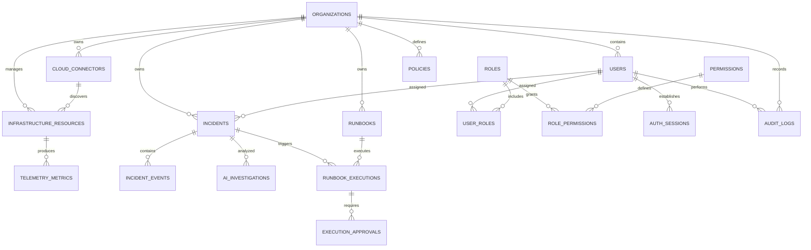
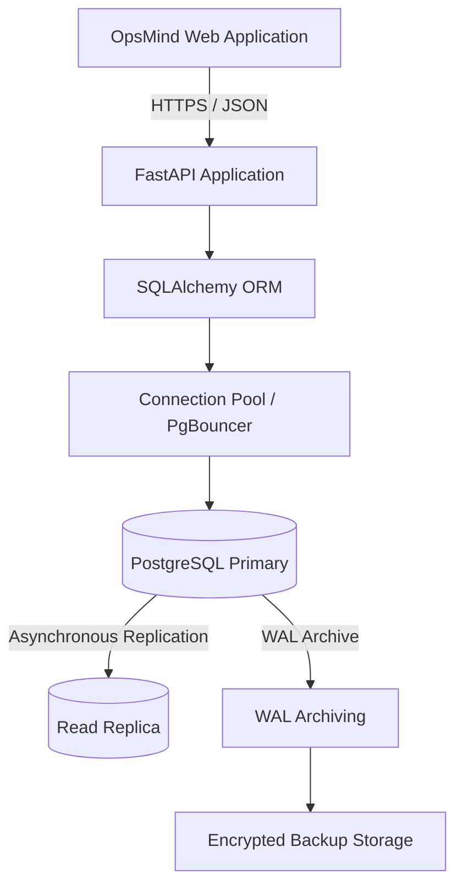

# OPSMIND ENTERPRISE
# Database Architecture & Schema Specification

**Document ID:** OPSMIND-DB-001  
**Document Owner:** Aryan Thakur — Lead Engineer  
**Document Status:** Approved for Architecture / Pending Implementation Validation  
**Version:** 1.0.0  
**Database Engine:** PostgreSQL 15 (Production Target)  
**Development Database:** SQLite 3 (Local Development, Where Supported)  
**ORM:** SQLAlchemy  
**Migration Framework:** Alembic  
**Connection Management:** SQLAlchemy Connection Pool / PgBouncer (Production, Where Required)  
**Primary Identifier Strategy:** UUID  
**Timestamp Standard:** UTC  
**Architecture:** Relational, Organization-Aware, Multi-Tenant

---

# 1. Database Architecture Overview

## 1.1 Purpose

This document defines the database architecture, entity relationships, relational schemas, indexing strategy, tenant-isolation model, data lifecycle, and recovery requirements for OpsMind Enterprise.

The database is a foundational component of the platform. It provides persistent storage for identity management, operational incidents, infrastructure integrations, observability data, automation workflows, and security audit records.

The architecture prioritizes transactional consistency, data integrity, tenant isolation, security, and predictable performance.

## 1.2 Architecture Objectives

| Objective | Engineering Requirement |
|---|---|
| Data Integrity | Enforce relational constraints and transactional consistency |
| Security | Protect authentication data, integration credentials, and sensitive records |
| Multi-Tenancy | Enforce organization-level data isolation |
| Performance | Optimize frequent operational queries through appropriate indexing |
| Scalability | Support increasing application and telemetry workloads |
| Reliability | Establish tested backup and recovery procedures |
| Auditability | Preserve traceable records of security-sensitive operations |
| Maintainability | Manage schema evolution through version-controlled migrations |

## 1.3 Database Design Principles

1. Use UUIDs for primary identifiers.
2. Enforce referential integrity through foreign keys.
3. Use `TIMESTAMPTZ` for time-sensitive records.
4. Store timestamps in UTC.
5. Normalize transactional entities to avoid unnecessary duplication.
6. Apply organization ownership to tenant-scoped records.
7. Store password hashes rather than plaintext passwords.
8. Store references to external secrets-management systems rather than plaintext cloud credentials.
9. Use transactions for operations that require atomicity.
10. Design indexes around measured query patterns.
11. Maintain schema changes through reviewed migrations.
12. Separate high-volume telemetry concerns from ordinary transactional workloads as the platform scales.

---

# 2. Database Technology & Environment Strategy

## 2.1 Database Selection

OpsMind uses PostgreSQL as its primary relational database for production-oriented environments.

SQLite may be used for lightweight local development and isolated testing where the application's SQLAlchemy models and required database behavior are compatible.

| Environment | Database | Purpose |
|---|---|---|
| Local Development | SQLite 3 / PostgreSQL | Developer workflows and testing |
| Integration Testing | PostgreSQL | Validate production-compatible behavior |
| Staging | PostgreSQL | Release validation and deployment testing |
| Production | PostgreSQL 15 target | Persistent application data |
| Analytics Expansion | PostgreSQL Read Replica | Read-heavy reporting workloads, where justified |

**Database compatibility requirement:** PostgreSQL-specific features such as JSONB, Row-Level Security, native enums, and certain indexing mechanisms are not directly interchangeable with SQLite. Production-critical migrations and tests must therefore run against PostgreSQL.

## 2.2 ACID Transaction Requirements

The database must preserve the ACID properties for critical application workflows.

| Property | Application |
|---|---|
| Atomicity | Incident updates and associated event records |
| Consistency | Foreign-key constraints and valid state transitions |
| Isolation | Concurrent transactions and organization-scoped operations |
| Durability | Committed operational records and audit events |

Critical operations must not leave partially updated application state.

For example, creating an incident and its initial timeline event should be performed within a single database transaction.

---

# 3. Entity Relationship Diagram (ERD)

## 3.1 Core Entity Relationship Model

The following diagram represents the principal entities and their relationships.



## 3.2 Entity Domains

| Domain | Core Tables | Responsibility |
|---|---|---|
| Identity | `organizations`, `users`, `auth_sessions` | Account and session management |
| Authorization | `roles`, `permissions`, `user_roles`, `role_permissions` | Role and permission enforcement |
| Integrations | `cloud_connectors` | External infrastructure connections |
| Infrastructure | `infrastructure_resources` | Discovered resource inventory |
| Observability | `telemetry_metrics` | Infrastructure metric observations |
| Incidents | `incidents`, `incident_events` | Incident lifecycle and history |
| Intelligence | `ai_investigations` | AI-assisted operational investigation |
| Automation | `runbooks`, `runbook_executions`, `execution_approvals` | Controlled remediation |
| Governance | `policies`, `audit_logs` | Policy and audit management |

---

# 4. Database Naming & Data Type Standards

## 4.1 Naming Conventions

| Database Object | Convention | Example |
|---|---|---|
| Tables | Plural `snake_case` | `audit_logs` |
| Columns | `snake_case` | `organization_id` |
| Primary Keys | `id` | `id UUID` |
| Foreign Keys | Referenced entity + `_id` | `user_id` |
| Indexes | `idx_<table>_<columns>` | `idx_incidents_status` |
| Unique Constraints | `uq_<table>_<columns>` | `uq_users_org_email` |
| Check Constraints | `chk_<table>_<rule>` | `chk_incidents_severity` |
| Foreign-Key Constraints | `fk_<table>_<reference>` | `fk_incidents_assignee` |

## 4.2 Standard Data Types

| Data Category | PostgreSQL Type | Usage |
|---|---|---|
| Primary Identifiers | UUID | Entity identity |
| Short Text | VARCHAR(n) | Names, statuses, identifiers |
| Long Text | TEXT | Descriptions and summaries |
| Integer Values | INTEGER / BIGINT | Counters and versions |
| Numeric Values | NUMERIC(p,s) | Precise decimal values |
| Telemetry Values | DOUBLE PRECISION | Metric observations |
| Boolean Values | BOOLEAN | Feature and state flags |
| Structured Metadata | JSONB | Flexible structured information |
| Network Addresses | INET | IP addresses |
| Timestamps | TIMESTAMPTZ | Time-aware event records |
| Binary Data | BYTEA | Only where binary storage is justified |

## 4.3 Standard Record Fields

Where applicable, entity tables should include:

| Column | Type | Requirement |
|---|---|---|
| `id` | UUID | Primary key |
| `created_at` | TIMESTAMPTZ | Record creation timestamp |
| `updated_at` | TIMESTAMPTZ | Last modification timestamp |

Application-managed timestamps must be consistent across database transactions and background workers.

---

# 5. Identity & Authentication Schema

## 5.1 `organizations`

Stores tenant and organization information.

| Column | Data Type | Constraints |
|---|---|---|
| `id` | UUID | PRIMARY KEY |
| `name` | VARCHAR(150) | NOT NULL |
| `slug` | VARCHAR(100) | UNIQUE, NOT NULL |
| `status` | VARCHAR(20) | NOT NULL |
| `plan` | VARCHAR(30) | NOT NULL |
| `created_at` | TIMESTAMPTZ | NOT NULL |
| `updated_at` | TIMESTAMPTZ | NOT NULL |

Responsibilities:

- Establish organization ownership.
- Provide the tenant boundary.
- Store organization-level configuration.
- Support organization lifecycle management.

## 5.2 `users`

Stores application user identities.

| Column | Data Type | Constraints |
|---|---|---|
| `id` | UUID | PRIMARY KEY |
| `organization_id` | UUID | NOT NULL, FOREIGN KEY |
| `email` | VARCHAR(255) | NOT NULL |
| `password_hash` | VARCHAR(255) | Nullable for external identity |
| `full_name` | VARCHAR(150) | NOT NULL |
| `status` | VARCHAR(20) | NOT NULL |
| `email_verified_at` | TIMESTAMPTZ | Nullable |
| `last_login_at` | TIMESTAMPTZ | Nullable |
| `created_at` | TIMESTAMPTZ | NOT NULL |
| `updated_at` | TIMESTAMPTZ | NOT NULL |

**Constraints and requirements:**

- Enforce normalized email uniqueness within an organization.
- Store only securely generated password hashes.
- Support external identity providers without requiring a local password.
- Validate organization membership.
- Never return password hashes through public API responses.

Recommended unique constraint:

`UNIQUE (organization_id, email)`

## 5.3 `roles`

Stores authorization roles.

| Column | Data Type | Constraints |
|---|---|---|
| `id` | UUID | PRIMARY KEY |
| `organization_id` | UUID | Nullable for platform-defined roles |
| `name` | VARCHAR(80) | NOT NULL |
| `description` | TEXT | Nullable |
| `is_system_role` | BOOLEAN | NOT NULL |
| `created_at` | TIMESTAMPTZ | NOT NULL |

Initial supported roles:

- `ADMIN`
- `SRE`
- `DEVOPS`
- `AUDITOR`
- `VIEWER`

## 5.4 `permissions`

Defines granular application permissions.

| Column | Data Type | Constraints |
|---|---|---|
| `id` | UUID | PRIMARY KEY |
| `code` | VARCHAR(120) | UNIQUE, NOT NULL |
| `description` | TEXT | Nullable |
| `resource` | VARCHAR(80) | NOT NULL |
| `action` | VARCHAR(80) | NOT NULL |

Example permission identifiers:

```text
dashboard.read
incidents.read
incidents.create
incidents.update
runbooks.read
runbooks.execute
integrations.create
integrations.delete
audit_logs.read
users.manage
policies.manage
```

## 5.5 `user_roles`

Maps users to roles.

| Column | Data Type | Constraints |
|---|---|---|
| `user_id` | UUID | FOREIGN KEY |
| `role_id` | UUID | FOREIGN KEY |
| `assigned_by` | UUID | FOREIGN KEY |
| `assigned_at` | TIMESTAMPTZ | NOT NULL |

Primary key:

`PRIMARY KEY (user_id, role_id)`

For tenant-aware authorization, role assignment must be validated against the user's organization. A user must not receive a role belonging to another organization.

## 5.6 `role_permissions`

Maps roles to permissions.

| Column | Data Type | Constraints |
|---|---|---|
| `role_id` | UUID | FOREIGN KEY |
| `permission_id` | UUID | FOREIGN KEY |
| `created_at` | TIMESTAMPTZ | NOT NULL |

Primary key:

`PRIMARY KEY (role_id, permission_id)`

## 5.7 `auth_sessions`

Tracks authenticated application sessions.

| Column | Data Type | Constraints |
|---|---|---|
| `id` | UUID | PRIMARY KEY |
| `user_id` | UUID | NOT NULL, FOREIGN KEY |
| `session_token_hash` | TEXT | UNIQUE, NOT NULL |
| `expires_at` | TIMESTAMPTZ | NOT NULL |
| `revoked_at` | TIMESTAMPTZ | Nullable |
| `created_at` | TIMESTAMPTZ | NOT NULL |
| `last_activity_at` | TIMESTAMPTZ | Nullable |

Raw session tokens must never be stored in the database.

---

# 6. Incident Management Schema

## 6.1 `incidents`

Stores operational incident records.

| Column | Data Type | Constraints |
|---|---|---|
| `id` | UUID | PRIMARY KEY |
| `organization_id` | UUID | NOT NULL, FOREIGN KEY |
| `incident_number` | VARCHAR(40) | NOT NULL |
| `title` | VARCHAR(255) | NOT NULL |
| `description` | TEXT | Nullable |
| `severity` | VARCHAR(5) | NOT NULL |
| `status` | VARCHAR(30) | NOT NULL |
| `source` | VARCHAR(50) | Nullable |
| `assigned_to` | UUID | Nullable, FOREIGN KEY |
| `created_by` | UUID | NOT NULL, FOREIGN KEY |
| `detected_at` | TIMESTAMPTZ | Nullable |
| `resolved_at` | TIMESTAMPTZ | Nullable |
| `created_at` | TIMESTAMPTZ | NOT NULL |
| `updated_at` | TIMESTAMPTZ | NOT NULL |

Severity values:

```text
P0
P1
P2
P3
P4
```

Lifecycle values:

```text
OPEN
ACKNOWLEDGED
INVESTIGATING
MITIGATING
RESOLVED
CLOSED
```

Recommended constraints:

- Severity must be one of the supported values.
- Status must be one of the defined lifecycle values.
- Incident numbers must be unique within an organization.
- Assigned users must belong to the same organization.
- Resolution timestamps must be consistent with lifecycle state.

## 6.2 `incident_events`

Stores incident history.

| Column | Data Type | Constraints |
|---|---|---|
| `id` | UUID | PRIMARY KEY |
| `organization_id` | UUID | NOT NULL, FOREIGN KEY |
| `incident_id` | UUID | NOT NULL, FOREIGN KEY |
| `actor_id` | UUID | Nullable, FOREIGN KEY |
| `event_type` | VARCHAR(80) | NOT NULL |
| `description` | TEXT | Nullable |
| `metadata` | JSONB | NOT NULL |
| `created_at` | TIMESTAMPTZ | NOT NULL |

Example event types:

```text
INCIDENT_CREATED
SEVERITY_CHANGED
STATUS_CHANGED
ASSIGNED
COMMENT_ADDED
RUNBOOK_TRIGGERED
REMEDIATION_COMPLETED
INCIDENT_RESOLVED
```

Incident history should be append-oriented. Changes must remain traceable rather than silently overwriting historical information.

---

# 7. Cloud Integration Schema

## 7.1 `cloud_connectors`

Stores external cloud-provider connection metadata.

| Column | Data Type | Constraints |
|---|---|---|
| `id` | UUID | PRIMARY KEY |
| `organization_id` | UUID | NOT NULL, FOREIGN KEY |
| `provider` | VARCHAR(30) | NOT NULL |
| `connection_name` | VARCHAR(150) | NOT NULL |
| `account_identifier` | VARCHAR(150) | Nullable |
| `auth_method` | VARCHAR(40) | NOT NULL |
| `secret_reference` | TEXT | Nullable |
| `region` | VARCHAR(80) | Nullable |
| `status` | VARCHAR(30) | NOT NULL |
| `last_validated_at` | TIMESTAMPTZ | Nullable |
| `created_by` | UUID | NOT NULL, FOREIGN KEY |
| `created_at` | TIMESTAMPTZ | NOT NULL |
| `updated_at` | TIMESTAMPTZ | NOT NULL |

Supported provider identifiers:

```text
AWS
GCP
AZURE
```

Connection lifecycle:

```text
PENDING
VALIDATING
CONNECTED
FAILED
DISCONNECTED
```

**Credential security requirements:**

- Prefer IAM roles and temporary credentials.
- Store secret references rather than raw access keys.
- Restrict secret retrieval to authorized backend services.
- Never expose provider secrets through frontend APIs.
- Redact credentials from logs, exceptions, and audit metadata.

## 7.2 `infrastructure_resources`

Stores discovered infrastructure resources.

| Column | Data Type | Constraints |
|---|---|---|
| `id` | UUID | PRIMARY KEY |
| `organization_id` | UUID | NOT NULL, FOREIGN KEY |
| `connector_id` | UUID | NOT NULL, FOREIGN KEY |
| `external_resource_id` | VARCHAR(255) | NOT NULL |
| `resource_name` | VARCHAR(150) | Nullable |
| `resource_type` | VARCHAR(100) | NOT NULL |
| `region` | VARCHAR(80) | Nullable |
| `environment` | VARCHAR(50) | Nullable |
| `status` | VARCHAR(30) | NOT NULL |
| `metadata` | JSONB | NOT NULL |
| `discovered_at` | TIMESTAMPTZ | NOT NULL |
| `updated_at` | TIMESTAMPTZ | NOT NULL |

A resource should be uniquely identifiable within its connector and organization.

---

# 8. Observability & Telemetry Schema

## 8.1 `telemetry_metrics`

Stores infrastructure metric observations.

| Column | Data Type | Constraints |
|---|---|---|
| `id` | UUID | PRIMARY KEY |
| `organization_id` | UUID | NOT NULL, FOREIGN KEY |
| `resource_id` | UUID | NOT NULL, FOREIGN KEY |
| `metric_name` | VARCHAR(120) | NOT NULL |
| `metric_value` | DOUBLE PRECISION | NOT NULL |
| `unit` | VARCHAR(30) | Nullable |
| `labels` | JSONB | NOT NULL |
| `recorded_at` | TIMESTAMPTZ | NOT NULL |
| `ingested_at` | TIMESTAMPTZ | NOT NULL |

Example metric identifiers:

```text
cpu_usage_percent
memory_usage_percent
disk_usage_percent
network_in_bytes
network_out_bytes
request_latency_ms
http_error_rate
```

### Telemetry Data Requirements

- Validate metric names and units.
- Store event time separately from ingestion time.
- Support time-range retrieval.
- Apply retention policies.
- Avoid unbounded metadata fields.
- Index common resource and time dimensions.
- Support aggregation for historical reporting.

**Scaling strategy:** The initial relational model establishes the telemetry data contract. As ingestion volume grows, evaluate time-based partitioning, aggregation tables, and specialized time-series storage. High-volume telemetry should not compromise latency-sensitive authentication and incident transactions.

---

# 9. AI Intelligence Schema

## 9.1 `ai_investigations`

Stores AI-assisted operational investigations.

| Column | Data Type | Constraints |
|---|---|---|
| `id` | UUID | PRIMARY KEY |
| `organization_id` | UUID | NOT NULL, FOREIGN KEY |
| `incident_id` | UUID | NOT NULL, FOREIGN KEY |
| `requested_by` | UUID | NOT NULL, FOREIGN KEY |
| `investigation_status` | VARCHAR(30) | NOT NULL |
| `model_identifier` | VARCHAR(120) | Nullable |
| `query` | TEXT | NOT NULL |
| `summary` | TEXT | Nullable |
| `confidence_score` | NUMERIC(5,4) | Nullable |
| `evidence` | JSONB | NOT NULL |
| `started_at` | TIMESTAMPTZ | NOT NULL |
| `completed_at` | TIMESTAMPTZ | Nullable |

Confidence values must be constrained to the range from 0 to 1 when provided.

## 9.2 `ai_recommendations`

Stores investigation recommendations.

| Column | Data Type | Constraints |
|---|---|---|
| `id` | UUID | PRIMARY KEY |
| `organization_id` | UUID | NOT NULL, FOREIGN KEY |
| `investigation_id` | UUID | NOT NULL, FOREIGN KEY |
| `recommendation_type` | VARCHAR(80) | NOT NULL |
| `description` | TEXT | NOT NULL |
| `risk_level` | VARCHAR(30) | NOT NULL |
| `confidence_score` | NUMERIC(5,4) | Nullable |
| `requires_approval` | BOOLEAN | NOT NULL |
| `status` | VARCHAR(30) | NOT NULL |
| `created_at` | TIMESTAMPTZ | NOT NULL |

AI-generated recommendations must retain evidence references and must not bypass operational authorization, approval, or execution policies.

---

# 10. Runbook & Automation Schema

## 10.1 `runbooks`

Stores registered operational procedures.

| Column | Data Type | Constraints |
|---|---|---|
| `id` | UUID | PRIMARY KEY |
| `organization_id` | UUID | NOT NULL, FOREIGN KEY |
| `name` | VARCHAR(150) | NOT NULL |
| `description` | TEXT | Nullable |
| `version` | INTEGER | NOT NULL |
| `execution_definition` | JSONB | NOT NULL |
| `risk_level` | VARCHAR(30) | NOT NULL |
| `approval_required` | BOOLEAN | NOT NULL |
| `enabled` | BOOLEAN | NOT NULL |
| `created_by` | UUID | NOT NULL, FOREIGN KEY |
| `created_at` | TIMESTAMPTZ | NOT NULL |
| `updated_at` | TIMESTAMPTZ | NOT NULL |

Runbook definitions must be validated before execution. The database must not be treated as a trusted execution environment.

## 10.2 `runbook_executions`

Stores execution history.

| Column | Data Type | Constraints |
|---|---|---|
| `id` | UUID | PRIMARY KEY |
| `organization_id` | UUID | NOT NULL, FOREIGN KEY |
| `runbook_id` | UUID | NOT NULL, FOREIGN KEY |
| `incident_id` | UUID | Nullable, FOREIGN KEY |
| `requested_by` | UUID | NOT NULL, FOREIGN KEY |
| `execution_status` | VARCHAR(30) | NOT NULL |
| `target_resource_id` | UUID | Nullable, FOREIGN KEY |
| `input_parameters` | JSONB | NOT NULL |
| `output_summary` | TEXT | Nullable |
| `started_at` | TIMESTAMPTZ | Nullable |
| `completed_at` | TIMESTAMPTZ | Nullable |
| `created_at` | TIMESTAMPTZ | NOT NULL |

Execution states:

```text
PENDING
AWAITING_APPROVAL
QUEUED
RUNNING
SUCCEEDED
FAILED
CANCELLED
```

## 10.3 `execution_approvals`

Tracks authorization decisions for privileged operations.

| Column | Data Type | Constraints |
|---|---|---|
| `id` | UUID | PRIMARY KEY |
| `organization_id` | UUID | NOT NULL, FOREIGN KEY |
| `execution_id` | UUID | NOT NULL, FOREIGN KEY |
| `requested_by` | UUID | NOT NULL, FOREIGN KEY |
| `reviewed_by` | UUID | Nullable, FOREIGN KEY |
| `status` | VARCHAR(30) | NOT NULL |
| `reason` | TEXT | Nullable |
| `requested_at` | TIMESTAMPTZ | NOT NULL |
| `reviewed_at` | TIMESTAMPTZ | Nullable |

Approval states:

```text
PENDING
APPROVED
REJECTED
EXPIRED
CANCELLED
```

Where separation of duties is required, the requester must not approve their own privileged execution.

---

# 11. Audit & Governance Schema

## 11.1 `audit_logs`

Stores security-sensitive and operational audit records.

| Column | Data Type | Constraints |
|---|---|---|
| `id` | UUID | PRIMARY KEY |
| `organization_id` | UUID | Nullable, FOREIGN KEY |
| `actor_id` | UUID | Nullable, FOREIGN KEY |
| `action` | VARCHAR(120) | NOT NULL |
| `resource_type` | VARCHAR(100) | NOT NULL |
| `resource_id` | UUID | Nullable |
| `outcome` | VARCHAR(30) | NOT NULL |
| `request_id` | VARCHAR(120) | Nullable |
| `source_ip` | INET | Nullable |
| `metadata` | JSONB | NOT NULL |
| `created_at` | TIMESTAMPTZ | NOT NULL |

Example audit events:

```text
USER_LOGIN
USER_LOGOUT
ROLE_ASSIGNED
INTEGRATION_CREATED
INTEGRATION_VALIDATION_FAILED
INCIDENT_CREATED
INCIDENT_RESOLVED
RUNBOOK_EXECUTED
POLICY_UPDATED
```

### 11.2 Audit Immutability Controls

Audit records must be append-oriented and protected against unauthorized modification.

Required controls:

- Revoke ordinary application-user `UPDATE` and `DELETE` permissions.
- Restrict audit writes to authorized application services.
- Separate administrative database privileges from application privileges.
- Avoid storing credentials and authentication tokens in metadata.
- Maintain timestamps and request correlation identifiers.
- Define retention and archival policies.
- Consider external append-only or immutable storage for stronger tamper resistance.

**Compliance qualification:** These controls support auditability but do not, by themselves, establish SOC 2 or ISO 27001 compliance. Formal compliance requires broader organizational controls, evidence, assessment, and independent validation.

---

# 12. Indexing & Query Optimization Strategy

Database indexes must be selected based on application query patterns and verified through PostgreSQL execution plans.

## 12.1 Core Index Definitions

| Index | Table | Indexed Columns | Purpose |
|---|---|---|---|
| `idx_users_email` | users | `organization_id, email` | Organization-scoped login lookup |
| `idx_incidents_status_severity` | incidents | `organization_id, status, severity` | Dashboard filtering |
| `idx_incidents_created_at` | incidents | `organization_id, created_at DESC` | Incident pagination |
| `idx_audit_created_at` | audit_logs | `organization_id, created_at DESC` | Audit-log retrieval |
| `idx_telemetry_resource_time` | telemetry_metrics | `resource_id, recorded_at DESC` | Time-series queries |
| `idx_resources_org_type` | infrastructure_resources | `organization_id, resource_type` | Resource inventory |
| `idx_sessions_expiry` | auth_sessions | `expires_at` | Session cleanup |
| `idx_notifications_user_read` | notifications | `user_id, read_at` | Notification retrieval |

## 12.2 Indexing Standards

- Prefer indexes that support actual filtering and sorting patterns.
- Use composite indexes where query predicates justify them.
- Evaluate partial indexes for frequently queried subsets.
- Consider BRIN indexes for suitable large, time-correlated datasets.
- Avoid redundant indexes.
- Monitor index size and write overhead.
- Use `EXPLAIN ANALYZE` for performance investigation.

**Performance qualification:** Sub-300 ms API P95 latency cannot be guaranteed through indexing alone. It depends on query design, database capacity, connection management, workload distribution, application processing, and network conditions.

---

# 13. Multi-Tenancy & Data Isolation

Organization-level data isolation is a critical security requirement.

## 13.1 Tenant Ownership

Tenant-scoped entities must carry an explicit organization identifier.

Examples:

- Users.
- Cloud connectors.
- Infrastructure resources.
- Telemetry metrics.
- Incidents.
- Incident events.
- AI investigations.
- AI recommendations.
- Runbooks.
- Runbook executions.
- Execution approvals.
- Policies.
- Notifications.
- Audit records.

## 13.2 Authorization & Query Enforcement

Every tenant-scoped query must enforce organization ownership.

The FastAPI application should:

1. Validate the authenticated session or token.
2. Resolve the user's active organization membership.
3. Determine the authorized organization context.
4. Apply that context to database queries.
5. Validate resource ownership before performing operations.

The organization identifier must not be trusted merely because it appears in a client-supplied request or JWT claim.

The authenticated identity and organization membership must be validated against trusted server-side authorization data.

## 13.3 PostgreSQL Row-Level Security

PostgreSQL Row-Level Security (RLS) can provide an additional database-enforced tenant-isolation layer.

Illustrative policy:

```sql
ALTER TABLE incidents ENABLE ROW LEVEL SECURITY;

ALTER TABLE incidents FORCE ROW LEVEL SECURITY;

CREATE POLICY incidents_tenant_isolation
ON incidents
USING (
    organization_id =
    NULLIF(
        current_setting('app.organization_id', true),
        ''
    )::uuid
)
WITH CHECK (
    organization_id =
    NULLIF(
        current_setting('app.organization_id', true),
        ''
    )::uuid
);
```

Application requirements:

- Set tenant context within the active database transaction.
- Use parameterized SQL and trusted server-side context.
- Clear or safely reset connection-specific context.
- Validate behavior with the actual application database role.
- Test connection-pool reuse and tenant-context isolation.
- Restrict roles that can bypass RLS.

RLS must be tested explicitly because database owners and roles with elevated privileges can behave differently from ordinary application roles.

---

# 14. Database Connection & Data Flow Architecture

## 14.1 Application Data Flow



## 14.2 Component Responsibilities

| Component | Responsibility |
|---|---|
| Web Application | Submit authenticated application requests |
| FastAPI | Validate requests and enforce authorization |
| SQLAlchemy | Manage database models and transactions |
| Connection Pool | Reuse and manage database connections |
| PgBouncer | Provide external connection pooling where needed |
| PostgreSQL Primary | Handle authoritative database writes |
| Read Replica | Support eligible read-heavy workloads |
| WAL Archiving | Preserve transaction logs for recovery |
| Backup Storage | Retain protected database backups and recovery artifacts |

## 14.3 Connection Management Requirements

- Configure connection-pool limits.
- Set appropriate connection timeouts.
- Use transaction-scoped sessions.
- Avoid leaking database sessions.
- Validate connection health.
- Monitor pool saturation.
- Evaluate PgBouncer when connection volume justifies it.

Read replicas may serve suitable analytics queries. Queries requiring read-after-write consistency or authoritative transaction state should use the primary database unless replica consistency is explicitly established.

---

# 15. Backup, Recovery & Retention Policy

## 15.1 Recovery Objectives

| Metric | Target |
|---|---|
| Recovery Time Objective (RTO) | 1 hour |
| Recovery Point Objective (RPO) | 15 minutes |
| Full Backup Frequency | Daily |
| Backup Schedule | 02:00 UTC |
| Full Backup Retention | 30 days |
| WAL Archiving | Continuous |

## 15.2 Backup Strategy

The production database backup strategy should include:

1. Scheduled full or base backups.
2. Continuous PostgreSQL WAL archiving.
3. Encrypted backup storage.
4. Restricted backup access.
5. Backup completion monitoring.
6. Periodic restoration testing.
7. Documented recovery procedures.

## 15.3 Point-in-Time Recovery

PostgreSQL Point-in-Time Recovery (PITR) allows recovery to a selected point within the available backup and WAL archive history.

The achievable recovery precision depends on successful WAL archiving, backup integrity, and recovery configuration.

PITR must be tested through actual restoration exercises. Continuous WAL archiving alone does not guarantee recovery to every second.

## 15.4 Data Retention Policy

| Data Category | Retention Policy |
|---|---|
| User Accounts | According to account lifecycle and deletion policy |
| Authentication Sessions | Expire and clean up after configured validity |
| Infrastructure Resources | Retain according to inventory lifecycle |
| Telemetry Metrics | Configurable time-based retention |
| Incident Records | Indefinite retention as the initial product target |
| Incident Events | Retain with associated incident history |
| AI Investigations | According to organization retention settings |
| Runbook Executions | According to operational and audit requirements |
| Audit Logs | 1 year minimum initial retention target |
| Notifications | Configurable expiration and cleanup |

Retention requirements must be reviewed against legal, contractual, security, and storage requirements before production deployment.

---

# 16. Database Migration & Version Control

All database schema changes must be version-controlled and applied through a migration framework.

**Migration Framework:** Alembic

## 16.1 Migration Requirements

- Every schema change must have a migration.
- Migrations must be reviewed before production execution.
- Destructive changes require explicit approval.
- Production migration behavior must be tested against PostgreSQL.
- Migration ordering must respect foreign-key dependencies.
- Rollback procedures must be documented where possible.
- Schema changes must be coordinated with application releases.

## 16.2 Migration Commands

```bash
# Generate a migration
alembic revision --autogenerate -m "create initial database schema"

# Apply migrations
alembic upgrade head

# Check current migration
alembic current

# View migration history
alembic history

# Roll back one migration where safe
alembic downgrade -1
```

Autogenerated migrations must be inspected manually before application.

---

# 17. Database Security Requirements

The database security model must protect both application records and the infrastructure on which they are stored.

## 17.1 Access Control

- Use a dedicated application database role.
- Avoid connecting the application using a PostgreSQL superuser.
- Grant only the permissions required by each service.
- Separate migration privileges from runtime privileges where practical.
- Restrict direct production database access.
- Monitor administrative database operations.

## 17.2 Data Protection

- Use encrypted connections.
- Protect database credentials through secrets management.
- Encrypt backups.
- Restrict access to sensitive metadata.
- Redact credentials from logs.
- Apply suitable encryption at rest through the deployment environment or storage layer.

## 17.3 Application Security

- Use parameterized SQL.
- Validate all external input.
- Enforce tenant ownership.
- Apply database constraints in addition to application validation.
- Protect audit records.
- Test authorization and cross-tenant isolation.

---

# 18. Performance & Operational Monitoring

The database must itself be observable.

## 18.1 Operational Metrics

| Metric | Purpose |
|---|---|
| Active Connections | Monitor connection utilization |
| Connection Pool Saturation | Identify application-side connection pressure |
| Query Latency | Detect slow database operations |
| Transaction Rate | Understand workload |
| Lock Waits | Identify contention |
| Deadlocks | Detect conflicting transactions |
| Cache Hit Ratio | Evaluate memory and query efficiency |
| Table and Index Size | Monitor storage growth |
| Replication Lag | Evaluate read-replica freshness |
| WAL Generation Rate | Monitor recovery and storage requirements |
| Backup Success Rate | Validate backup operations |

## 18.2 Performance Validation

Database performance must be validated using:

- Representative datasets.
- Realistic concurrency.
- Query-plan inspection.
- Load testing.
- Connection-pool monitoring.
- Index-usage analysis.
- Replication-lag measurements.

Performance objectives must be evaluated together with the application-level API targets defined in the OpsMind PRD.

---

# 19. Implementation & Deployment Sequence

The database should be implemented incrementally in dependency order.

| Phase | Scope | Deliverable |
|---|---|---|
| Phase 1 | Organizations, Users, Sessions | Identity foundation |
| Phase 2 | Roles, Permissions, Assignments | RBAC foundation |
| Phase 3 | Cloud Connectors, Resources | Integration persistence |
| Phase 4 | Incidents, Incident Events | Incident lifecycle |
| Phase 5 | Telemetry Metrics | Observability persistence |
| Phase 6 | AI Investigations, Recommendations | Intelligence records |
| Phase 7 | Runbooks, Executions, Approvals | Automation persistence |
| Phase 8 | Policies, Audit Logs, Notifications | Governance foundation |
| Phase 9 | Indexes, RLS, Backup, Monitoring | Database hardening |

Each phase must include migrations, model validation, API integration where applicable, and automated tests before the next phase begins.

---

# 20. Database Acceptance Criteria

## Schema & Integrity

- [ ] Primary keys and foreign keys are defined.
- [ ] Unique and check constraints are implemented.
- [ ] Timestamp handling is consistent.
- [ ] Migration history is version-controlled.
- [ ] PostgreSQL integration tests pass.

## Authentication & Authorization

- [ ] Password hashes are stored securely.
- [ ] Session tokens are not stored in plaintext.
- [ ] Role and permission relationships are enforced.
- [ ] Cross-organization role assignment is prevented.
- [ ] Session revocation and expiration are supported.

## Multi-Tenancy

- [ ] Tenant-owned tables include organization ownership.
- [ ] Cross-tenant access tests pass.
- [ ] RLS policies are validated where enabled.
- [ ] Connection-pool tenant context cannot leak between requests.

## Operational Data

- [ ] Incident lifecycle is persisted.
- [ ] Incident event history is traceable.
- [ ] Cloud integrations store secret references.
- [ ] Telemetry supports time-range queries.
- [ ] Runbook executions and approvals are recorded.

## Security & Recovery

- [ ] Application database role uses least privilege.
- [ ] Audit modification privileges are restricted.
- [ ] Sensitive values are excluded from logs.
- [ ] Backups are encrypted and monitored.
- [ ] Restoration procedures are tested.
- [ ] RTO and RPO targets are validated.

---

# 21. Future Architecture Considerations

The database architecture should evolve based on measured requirements rather than premature complexity.

Potential future extensions include:

- Dedicated time-series storage.
- Advanced telemetry aggregation.
- Service dependency graph persistence.
- Distributed tracing storage.
- Alert correlation and event deduplication.
- FinOps cost and usage records.
- AI model evaluation and feedback.
- Advanced compliance evidence management.
- Organization hierarchies and delegated administration.
- High-availability PostgreSQL deployment architecture.

Each extension should be introduced through an explicit architectural decision and reviewed migration.

---

# 22. Architecture Governance

This document is the authoritative database design reference for the initial OpsMind implementation.

Changes to core entities, tenant boundaries, authorization relationships, audit controls, or recovery architecture must undergo engineering review.

Database schema changes must be documented, tested, and released through version-controlled migrations.

### Version History

| Version | Description | Status |
|---|---|---|
| 1.0.0 | Initial enterprise database architecture specification | Approved for Architecture |

---

<div align="center">

**OPSMIND ENTERPRISE**

**RELIABLE DATA. SECURE OPERATIONS. INTELLIGENT INFRASTRUCTURE.**

*Built for engineers. Designed for infrastructure.*

</div>
